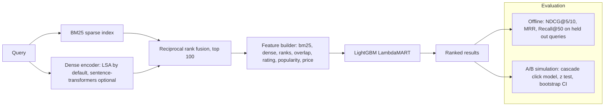

# search-ranking-recsys

A two stage product search demo: **hybrid retrieval** (BM25 + dense embeddings, fused with reciprocal rank fusion) followed by a **learning-to-rank** reranker (LightGBM LambdaMART, with a scikit-learn logistic regression baseline). It ships with offline evaluation (NDCG, MRR, Recall) and an **online A/B simulation** using a position-biased click model. Everything runs on CPU, offline, in seconds.

> Portfolio demo on a synthetic catalogue. The numbers below show the pipeline working end to end; they are not claims about real traffic.

## Problem

Search and recommendation teams usually split ranking into:

1. **Candidate generation:** cheap, high recall retrieval over the whole catalogue. Lexical BM25 is strong on exact terms, dense embeddings help with synonyms ("rucksack" vs "backpack"). Neither wins everywhere, so they are fused.
2. **Reranking:** an expensive model over the top 100 candidates that can use non text signals (rating, popularity, price) and is trained directly for a ranking metric.
3. **Evaluation:** offline metrics to iterate fast, then an online experiment to confirm the gain is real.

## Architecture



## Results (synthetic data, 1,200 items, 300 queries, 70/30 query split)

Offline evaluation on held out queries (`python -m recsys.evaluate`):

| System | NDCG@5 | NDCG@10 | MRR | Recall@50 |
|---|---|---|---|---|
| bm25 retrieval | 0.838 | 0.837 | 1.000 | 0.690 |
| dense retrieval | 0.810 | 0.789 | 0.994 | 0.667 |
| hybrid retrieval | 0.824 | 0.809 | 1.000 | 0.681 |
| hybrid + logistic regression | 0.914 | 0.891 | 1.000 | 0.747 |
| hybrid + LightGBM LambdaMART | 0.988 | 0.986 | 1.000 | 0.786 |

A/B simulation, 20,000 sessions, 50/50 split (`python -m recsys.ab_sim`):

| Arm | Ranker | CTR@10 |
|---|---|---|
| Control | BM25 | 0.866 |
| Treatment | Hybrid + LambdaMART | 0.906 |

Absolute lift +3.9 points, 95% bootstrap CI [+3.2, +4.8], z = 8.7.

How to read this honestly:

- The relevance labels come from the generator's hidden rule (topic match, demoted for poorly rated items). The reranker wins mainly because it can see `rating`, which text retrieval cannot. That is the realistic lesson (rerankers add value through non text signals), but the size of the gap is a property of the synthetic data.
- MRR is near 1.0 for every system because each query has many relevant items; NDCG is the more informative metric here.
- On this catalogue, plain BM25 beats the LSA encoder and the fused list. The dense side earns its place on synonym queries (see `test_dense_handles_synonyms`). A real sentence-transformers model would change this table, which is why the encoder is pluggable.

## Run it

```bash
python -m venv .venv && . .venv/bin/activate
pip install -e ".[dev]"

python -m recsys.evaluate          # writes reports/offline_eval.{md,json}
python -m recsys.ab_sim            # writes reports/ab_simulation.json
uvicorn recsys.api:app --reload    # http://localhost:8000/search?q=waterproof+trail+running+shoes
# or
docker compose up --build
```

`/search` supports `mode=ltr` (default), `hybrid`, `bm25` or `dense`, so you can compare rankers by hand.

Optional real embeddings: `pip install -e ".[st]"` and pass `SentenceTransformerEmbedder()` to `HybridRetriever` (downloads a small model; not used in CI).

## Tests

```bash
ruff check . && pytest -q
```

- Metric correctness (DCG formula, perfect and worst rankings, MRR, recall)
- BM25 scoring and IDF behaviour, normalised dense vectors, synonym handling, deterministic data
- LambdaMART beats BM25 on held out queries and the feature importance includes `rating`
- Click model, z test sanity checks and an end to end A/B run that must detect the lift
- API tests through FastAPI's test client

CI runs lint and tests on Python 3.11 and 3.12, publishes the offline eval table to the job summary, uploads the reports as an artifact and smoke tests the Docker image.

## Design decisions

- **Own BM25 on a sparse matrix.** About 40 lines with precomputed saturated term weights, so a query is one sparse matrix product. No Elasticsearch needed for a demo, and the maths stays visible.
- **LSA as the default encoder.** Word + character n-gram TF-IDF reduced with SVD gives cheap, offline "embeddings" that still catch morphology. The `Embedder` protocol makes swapping in a transformer a one line change.
- **Reciprocal rank fusion** rather than score blending, because BM25 scores and cosine similarities live on different scales. Ranks and raw scores are also passed to the reranker as features.
- **LambdaMART** optimises a ranking objective directly; logistic regression is included as an honest baseline so the gain is measured, not assumed.
- **Query level split.** Train and test never share a query, otherwise the reranker would memorise labels.
- **Cascade click model with position bias** for the A/B simulation, because online CTR is driven by what is at the top, not by full list NDCG.

## Limitations

- Synthetic catalogue and labels; no real user behaviour.
- Exhaustive scoring over the catalogue (fine for thousands of items). Millions would need an inverted index and an ANN index such as FAISS or HNSW.
- No feature store, no online learning, no counterfactual (IPS) evaluation of logged clicks.
- The model is retrained at API start up for simplicity instead of being loaded from a registry.

## License

MIT
